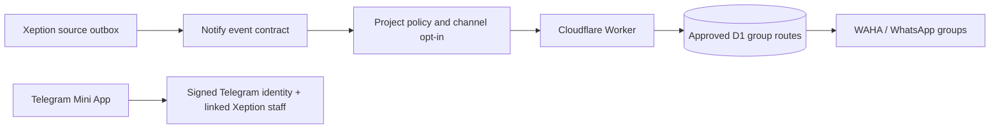

<!-- appfactory:hero:start -->
<div align="center">

# Trigenys Notify

### One event. The right channel. The right team.

**Multi-product operational notifications with guarded Telegram interactions and approval-based WhatsApp group routing — without turning an accepted message into a delivery promise.**

[](#delivery-maturity)
[](#telegram-mini-app-first-implementation)
[](#routing-and-trust-model)
[](#routing-and-trust-model)

[**Use case**](#why-trigenys-notify) · [**Routing**](#routing-and-trust-model) · [**Maturity**](#delivery-maturity) · [**Mini App**](#telegram-mini-app-first-implementation) · [**Setup**](#run) · [**Status**](#status)

</div>

---
<!-- appfactory:hero:end -->

## Why Trigenys Notify

A notification is useful only when it reaches the **right authorized audience** and can be retried without duplicating unrelated channels. Notify is a reusable operational event and channel-routing layer; Xeption supplies the first real business events and retains its durable notification outbox.

## Routing and trust model



A discovered WhatsApp group is only a **candidate**. Explicit admin approval is required; repeat attempts reuse delivery receipts and a permitted fallback never silently changes tenant ownership. Staff Mini App access depends on both Telegram-signed identity and Xeption account authorization. [Routing evidence](docs/waha-group-routing.md) · [Source outbox and cutover](docs/central-whatsapp-dispatch.md).

## Delivery maturity

**Beta.** Contract validation, multigroup routing and Telegram staging UI are implemented, but an HTTP 202 only indicates the provider accepted the event — **not** that staff read it. Duplicate delivery remains possible after failure between transport acceptance and durable receipt. The Telegram staging write flag remains disabled pending separate validation; neither automated conversational agents nor unsupervised group routing are claimed.

Current readiness is documented in [shared channels](docs/reuse-and-channels.md) and [Mini App security](docs/telegram-miniapp.md).

A reusable staff-notification and interaction service, bootstrapped by [Trigenys AppFactory](https://github.com/Trigenys/appfactory). Xeption is its first consuming application.

## Telegram Mini App (first implementation)

This repo now includes a mobile-first **Telegram Mini App** for the **existing Xeption staff bot**. The **staging UI and its Xeption delegated API are deployed** on Cloudflare; ERP ↔ Telegram linking and protected staff actions are being finalized separately.

- `GET /miniapp`: responsive Telegram interface (built-in static assets)
- `GET /v1/miniapp/public-config`: public Supabase URL and anon key only
- `GET /v1/miniapp/session`: Telegram HMAC identity + verified linked Xeption staff
- `POST /v1/miniapp/link`: attach a Telegram user to an authenticated Xeption staff member
- `GET /v1/miniapp/items?category=alerts|stock|images|trocs|marketplace`: role-aware and PII-minimized views
- `POST /v1/miniapp/ack`: audited acknowledgment (feature-flagged)
- `POST /v1/miniapp/troc-action`: guarded `contacted` or `refused` transitions
- `POST /v1/miniapp/marketplace-sold`: guarded active → sold state change

Direct mutations are **OFF** until the Xeption migration and staging security tests pass. Inventory updates and photo uploads remain in Xeption ERP.

The Mini App verifies Telegram's signed `initData` server-side and requires a one-to-one binding to a **current, real Xeption staff account**. A Telegram group member without Xeption staff permission cannot access the data.

## Run

Requires Node.js 24+.

```bash
npm install
npm run check
npm run dev
```

Copy and securely configure `.env.example`. Node does not automatically load the file for `npm run dev`; provide host environment variables (or use Node's `--env-file` when explicitly launching Node in local development). Never commit a bot token or Supabase service-role key.

Main references:

- [Transactional email through SMTP](docs/transactional-email.md): scoped product API, centrally configured sender/credentials and D1 receipts. Commerce Factory is the first email consumer; activation remains off until Spacemail credentials and real delivery are verified.

- [Reusable event contract, tenant policies and optional WAHA adapter](docs/reuse-and-channels.md)
- [Generic WhatsApp group dispatch](docs/generic-whatsapp-dispatch.md): `POST /v1/dispatch/{project}/whatsapp`, same envelope and per-project auth as email, delivery only to the project's declared `@g.us` groups. Trigenys Studio is declared, disabled until its « Studio Comm » group exists.
- [Central WhatsApp dispatch owned by Trigenys Notify](docs/central-whatsapp-dispatch.md) — opt-in, remains disabled until security cutover
- [Meta Cloud API officielle pour Atelier Maître](docs/meta-cloud-atelier.md) — adaptateur et route privée, désactivés par défaut
- [Manually run live staging checks](.github/workflows/staging-smoke.yml) or use `npm run smoke:staging` (read-only).

- [Mini App security and staging runbook](docs/telegram-miniapp.md)
- [ADR-001 — Reuse the existing Xeption notification engine](docs/adr-001-xeption-reuse.md)
- [Xeption migration PR](https://github.com/EagleFox31/xeption237/pull/20)

## Why not a second bot?

Xeption already has Telegram sending, persistent `admin_notifications`, per-channel retries, de-duplication and scheduled relay. A parallel sender would duplicate messages and create split delivery histories. Trigenys Notify extends the existing bot with operational workflows, then extracts reusable shared contracts for other Trigenys products.

## Status

AppFactory project: provisioned. Mini App interface: deployed in Cloudflare staging. Xeption notification sending remains in the original Supabase relay. Reusable core contracts, tenants and optional Telegram/WAHA transport adapters are available **as library code only**, with no additional sender switched on. The ERP ↔ Telegram account-linking flow is a separate, ongoing change. The staging write flag remains disabled; this repository does not attempt to deploy SQL or bot credentials.
